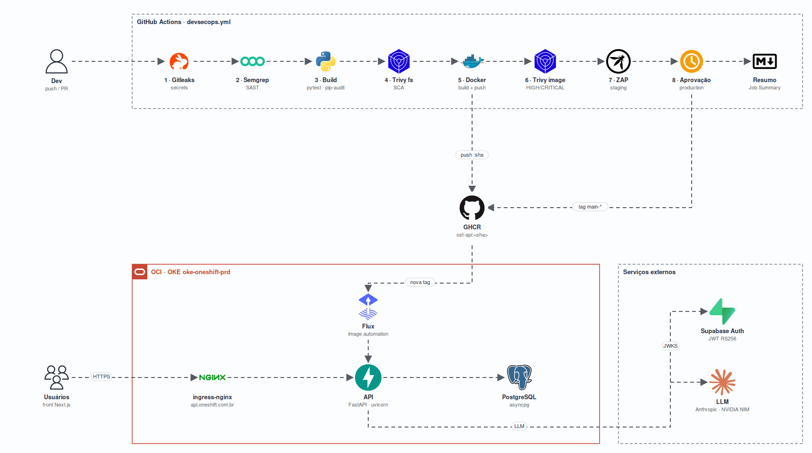

<h1 align="center">
  OneShift API
</h1>

<p align="center">
  
</p>

<p align="center">
  <a href="https://skillicons.dev">
    
  </a>
</p>

<p align="center">
  <a href="https://github.com/Oneshift-Organization/ost-backend.python/actions/workflows/devsecops.yml">
    
  </a>
</p>

## Qual a finalidade do projeto?

Backend da **OneShift**, plataforma do Challenge 2026 que lê o billing de AWS, GCP, Azure e OCI, cota a infraestrutura equivalente em cada nuvem, calcula o risco de dependência do provedor e gera recomendações de migração para CFOs e controllers.

O repositório também é a entrega do **CP 03 de DevSecOps**: a API chega à produção por uma esteira no GitHub Actions que verifica a segurança em cada etapa, publica um relatório por etapa e só faz o deploy depois de uma aprovação humana.

## Integrantes

| Nome | RM |
|---|---|
| | |

## Arquitetura

| Componente | Descrição |
|---|---|
| API | FastAPI + uvicorn, Python 3.12, executando como usuário sem privilégio |
| Banco | PostgreSQL no cluster, acessado com SQLAlchemy async (asyncpg) |
| Autenticação | Supabase Auth: a API valida o JWT RS256 |
| IA | LLM (Anthropic ou NVIDIA NIM) só narra números já calculados pelo backend |
| Produção | Cluster OKE na OCI, exposto pelo ingress-nginx em `api.oneshift.com.br` |
| Deploy | Flux acompanha as tags `main-*` no GHCR e atualiza o deployment |

## Esteira DevSecOps

Workflow em [`.github/workflows/devsecops.yml`](.github/workflows/devsecops.yml). As etapas são sequenciais: cada uma só roda se a anterior passou. O **Resumo da Esteira** roda sempre, mesmo quando uma etapa falha.

| # | Etapa | Ferramenta | Objetivo | Quality gate | Relatório |
|---|---|---|---|---|---|
| 1 | Secrets | Gitleaks 8.30.1 | Credenciais no histórico completo do Git | Bloqueia | `relatorio-01-gitleaks` |
| 2 | SAST | Semgrep (`p/default`, `p/owasp-top-ten`) | Falhas no código-fonte, com SARIF na aba Security | Bloqueia | `relatorio-02-semgrep` |
| 3 | Build | pip, pytest, pipdeptree, pip-audit | Testes, árvore de dependências e artefato `ost-api-<sha>.tar.gz` | Bloqueia (testes) | `relatorio-03-build` |
| 4 | SCA | Trivy fs | CVEs, misconfig e segredos no repositório | Bloqueia HIGH/CRITICAL | `relatorio-04-trivy-sca` |
| 5 | Imagem | Docker Buildx + GHCR | Imagem `ost-api:<sha>` multi-stage, sem root | Bloqueia (build/push) | `relatorio-05-docker-build` |
| 6 | Scan da imagem | Trivy image | CVEs do sistema base e das bibliotecas da imagem | Bloqueia HIGH/CRITICAL com correção | `relatorio-06-trivy-image` |
| 7 | Staging + DAST | OWASP ZAP Baseline | A imagem sobe no runner com um Postgres descartável e o ZAP testa de fora | Informativo | `relatorio-07-homologacao-zap` |
| 8 | Produção | GitHub Environments | Aprovação no environment `production` e promoção da imagem | Aprovação manual | `relatorio-08-producao` |

Os relatórios ficam nos artifacts de cada [execução](https://github.com/Oneshift-Organization/ost-backend.python/actions/workflows/devsecops.yml).

### Branches

- `develop` e `main`, em push e pull request: etapas 1 a 7 e o resumo.
- `main`, em push: também a etapa 8, que espera a aprovação de um revisor do environment `production`.

### Deploy sem rebuild

A etapa 8 não reconstrói a imagem. Ela cria a tag `main-<timestamp>-<sha>` apontando para o **mesmo digest** escaneado nas etapas 5 a 7. O Flux do cluster acompanha essas tags e atualiza o deployment. Por isso a esteira não precisa de credencial da nuvem: o único token usado é o `GITHUB_TOKEN`, com permissão de escrita de pacotes apenas nos jobs que publicam.

### Supressões

| Arquivo | O que suprime | Por quê |
|---|---|---|
| [`.gitleaksignore`](.gitleaksignore) | 2 achados em `scripts/sync_prices.py` | A regra casou com o nome do atributo `gcp_billing_api_key`, não com um valor |
| [`.trivyignore`](.trivyignore) | CVE-2026-116587 (go-jose no binário do Terraform) | Sem correção num release do Terraform; a API só roda `fmt` e `validate` offline |
| `nosemgrep` | `dynamic-urllib-use-detected` em 7 chamadas | URLs com host fixo das APIs de preço e câmbio, ou com esquema validado |

### Aprovação em produção

| Data | Aprovado por | Base da decisão |
|---|---|---|
| | | |

## Como executar

### Local

```bash
python3.12 -m venv .venv
source .venv/bin/activate
pip install -r requirements-dev.txt
cp .env.example .env.dev
alembic upgrade head
uvicorn app.main:app --reload --reload-dir app
```

As dependências de produção têm versão fixa em `requirements.txt`, gerado a partir de `requirements.in`:

```bash
uv pip compile requirements.in --python-version 3.12 --python-platform x86_64-unknown-linux-gnu -o requirements.txt
```

### Docker

```bash
docker compose up -d --build
```

API em `http://localhost:8000` e documentação em `http://localhost:8000/docs`.

## Produção

https://api.oneshift.com.br
