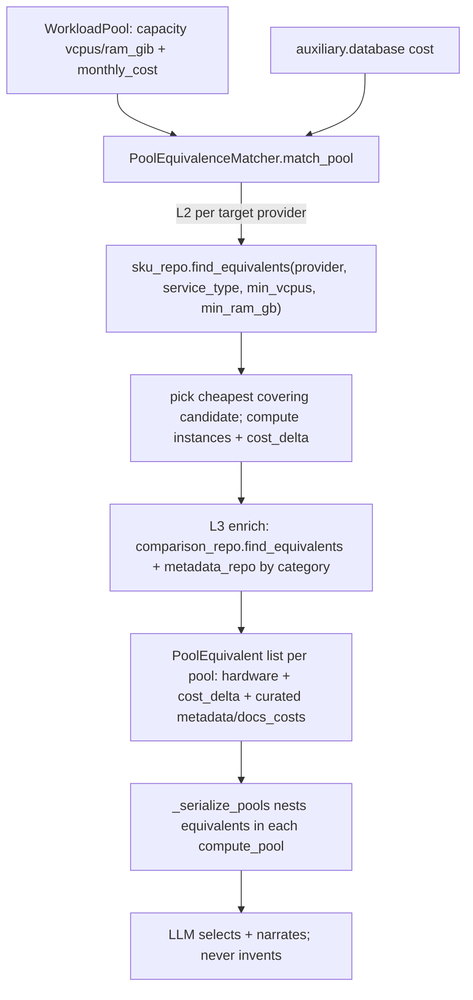

# Equivalência Cross-Cloud (DE-PARA por Capacity Pool)

> Complementa [`capacity-pool-model.md`](capacity-pool-model.md),
> [`sku-matching.md`](sku-matching.md) and [`architecture.md`](architecture.md).
> Defines **how** the backend feeds the LLM deterministic cross-cloud
> alternatives (DE-PARA) for each Capacity Pool, so the model **narrates** a
> migration instead of **inventing** target instances and prices.
> **Scope of this document: spec only.** Implementation = work units §7.

## 0. Context

The Capacity Pool refactor gave us excellent **resource auto-recognition**: the
backend aggregates atomic billing lines into `WorkloadPool` objects with real
`capacity = {vcpus, ram_gib}` and `costs` (see
[`capacity-pool-model.md`](capacity-pool-model.md) §2). But it **dropped the cross-cloud
DE-PARA** that the pre-pool design had.

**What the LLM receives today** ([`run_analysis_pipeline.py`](../app/use_cases/analysis/run_analysis_pipeline.py)
`_serialize_pools`): `compute_pools` (capacity + cost), `auxiliary_costs`,
`mapping_confidence`. **Zero** cross-cloud alternatives.

**What the prompt then asks** ([`orchestrator.py:47-48`](../app/infrastructure/llm/orchestrator.py)),
rule #2 verbatim: *"Para cada compute_pool, **desenhe um mix de instâncias** na
nuvem de destino (AWS, OCI) capaz de suportar a capacidade agregada"*. We are
**explicitly instructing the LLM to invent** target SKUs and prices — the exact
hallucination risk [`architecture.md`](architecture.md) forbids ("no math in LLM").

**What the old design did.** Pre-refactor, the backend sent an `equivalents`
array per workload, e.g.:

```json
"equivalents": [
  {"provider": "OCI", "service_name": "MySQL HeatWave", "category": "database",
   "service_type": "relational_database",
   "technical_match": {"vcpus": 1.0, "ram_gb": 8.0},
   "financials": {"estimated_monthly_cost": 3.8, "cost_delta": -100.16}},
  {"provider": "AWS", "service_name": "AmazonRDS", "category": "database",
   "service_type": "relational_database",
   "technical_match": {"vcpus": 2.0, "ram_gb": 4.0},
   "financials": {"estimated_monthly_cost": 6.7, "cost_delta": -97.26}}
]
```

The LLM was fed the factual options and only **chose + explained**.

### Key finding (corrects the original premise)

The old equivalence code is **not** on `dev/feat/billing-data-export` — that
branch shares this branch's merge-base and never had it. The DE-PARA machinery
is **intact on the current branch** and still runs:
[`equivalence_matcher.py`](../app/domain/services/equivalence_matcher.py)
(`EquivalenceMatcher`, `get_equivalents`), the `EquivalentService` /
`TechnicalMatch` / `FinancialEstimate` entities
([`domain/analysis.py:30-53`](../app/domain/analysis.py)), and
[`build_migration_context.py:246-303`](../app/use_cases/analysis/build_migration_context.py)
which **still computes** `ctx.workloads[].equivalents`.

**So this is a re-wiring, not a recovery.** Two precise breaks:

1. **Computed then discarded.** `build_migration_context` fills
   `ctx.workloads[].equivalents`, but `_serialize_pools` only serializes pools —
   the equivalents never reach the LLM.
2. **Wrong granularity / wrong key.** The matcher matches **per SKU** and needs
   a `sku_id` carrying `vcpus`+`ram`. After the SKU-accuracy work, GCP compute
   lines match by **rule (L2)** with `sku_id = None`
   ([`sku-matching.md`](sku-matching.md) §4), and cloud providers bill
   **atomic Core/RAM** lines — there is no single source SKU with full specs. So
   the per-SKU matcher returns **no equivalents** for exactly the workloads we
   care about.

### The idea — three layers, not two

The DE-PARA evolved through two distinct historical mechanisms, **both still
present on this branch**, and the right answer composes both on top of the new
pool recognition:

| Layer | Source | What it gives |
|---|---|---|
| **L1 — Capacity** | Pools (current) | real `{vcpus, ram_gib}` per project/family |
| **L2 — Hardware equivalent + `cost_delta`** | [`equivalence_matcher.py`](../app/domain/services/equivalence_matcher.py) (commit `a6b00cd`) | cheapest target SKU covering the capacity + savings math |
| **L3 — Curated knowledge** | service-catalog DE-PARA (commit `7e3b2c6`, still live) | per-service `metadata` + `docs_costs` (portability, lock-in, gotchas) |

The `WorkloadPool` **is** the auto-recognized resource (L1): it holds the
aggregated `{vcpus, ram_gib}` the per-SKU path could no longer reconstruct.

- **L2** — match equivalents **at the pool level**, reusing the existing repo
  query
  [`find_equivalents(provider, service_type, min_vcpus, min_ram_gb)`](../app/infrastructure/repositories/pg_cloud_sku_repo.py#L49)
  (already returns candidates ≥ capacity, ordered by lowest price).
- **L3** — enrich each L2 target with the **curated `metadata` + `docs_costs`**
  the original catalog DE-PARA carried. This is what the hardware-only matcher
  *lost*: the qualitative migration knowledge (434 curated rows in
  [`seed_service_metadata.py`](../app/infrastructure/database/seed_service_metadata.py))
  that stopped the LLM from guessing portability/lock-in. Reuse the still-live
  [`PGServiceComparisonRepository.find_equivalents(category, exclude_provider)`](../app/infrastructure/repositories/service_repositories.py#L70)
  and
  [`PGServiceMetadataRepository.list_by_provider_and_category(provider, category)`](../app/infrastructure/repositories/service_repositories.py#L23).

This **merges the new recognition (L1) with both old DE-PARA layers (L2 + L3)**.

> **Historical note.** The old catalog DE-PARA (`7e3b2c6`) matched by
> service-name → `category`/`service_type` and attached `metadata`/`docs_costs`,
> but had **no** vcpus/ram or `cost_delta`. The hardware matcher (`a6b00cd`)
> added `technical_match` + `cost_delta` but **dropped** the curated knowledge.
> Neither alone is the old experience — this spec restores both. The
> `lastversion`/`billing-data-export` snapshot (`5475fac`) is older still: F1
> ingestion only, with no DE-PARA at all.

### FOCUS alignment

[FOCUS](https://focus.finops.org/) gives the shared vocabulary that makes the
DE-PARA auditable across providers. Each equivalent is emitted with FOCUS-aligned
fields so source and target are comparable on the same axes (extends the mapping
table in [`capacity-pool-model.md`](capacity-pool-model.md) §3.1):

| FOCUS column | Source (pool) | Target (equivalent) |
|---|---|---|
| `ServiceCategory` | pool category (compute/database) | `equivalent.category` |
| `ServiceName` | — | `equivalent.service_name` |
| `SkuId` | `_pool` key (composite) | `equivalent.sku_id` (structured target SKU) |
| `RegionId` | `pool.region` | target region |
| `PricingQuantity` (vCPU/RAM) | `pool.capacity` | `technical_match` |
| `EffectiveCost` | `pool.monthly_cost` | `financials.estimated_monthly_cost` |
| `x_Metadata` (provider extension) | — | `equivalent.metadata` (L3 curated) |
| `x_DocsCosts` (provider extension) | — | `equivalent.docs_costs` (L3 curated) |

## 1. Goals

- **G1 — Factual DE-PARA.** Every `compute_pool` with capacity > 0 and the
  `database` auxiliary bucket carry ≥1 backend-computed `equivalent` per viable
  target provider (no LLM invention).
- **G2 — Reuse, not rebuild.** Reuse `EquivalenceMatcher.get_equivalents` + the
  `find_equivalents` SKU query (L2), **and** the curated
  `PGServiceComparisonRepository` / `PGServiceMetadataRepository` (L3); keep the
  existing `EquivalentService` / `TechnicalMatch` / `FinancialEstimate` contract.
- **G3 — Deterministic math in backend.** `estimated_monthly_cost`, `cost_delta`
  computed in Python (`Decimal`); the LLM only **selects and narrates**.
- **G4 — Traceability.** Each equivalent records how it was produced
  (`match_basis = pool_capacity`, target `sku_id`, `pricing_confidence`) plus the
  curated `metadata`/`docs_costs` — a FOCUS-aligned, auditable DE-PARA.
- **G5 — Restore curated knowledge.** Each equivalent carries the `metadata`
  (portability, lock-in, cost drivers) and `docs_costs` from the curated catalog,
  so the LLM narrates qualitative trade-offs without inventing them.

## 2. Non-Goals

- No real-time pricing (mock catalog prices stay; `pricing_confidence` carries
  the caveat — [`architecture.md`](architecture.md)-Goals).
- No change to the SKU **classification** ladder (that is
  [`sku-matching.md`](sku-matching.md)); this spec consumes its output.
- No new endpoints — only enrich the payload of the existing analysis flow (§6).
- No LLM-side math.

## 3. Existing endpoints (analysis flow — unchanged surface)

`APIRouter(prefix="/analyses")`
([`app/api/v1/routes/analysis.py`](../app/api/v1/routes/analysis.py)):

| Method | Path | Role | Touched by this spec |
|---|---|---|---|
| POST | `/analyses/migration-context` | build + return migration context | payload gains pool `equivalents` |
| POST | `/analyses/start/{report_id}` | start async analysis job | indirect (uses serializer) |
| GET | `/analyses/{job_id}/agents-payload` | the migration context for agents | response gains `equivalents` |
| GET | `/analyses/{job_id}/result` | final structured report | richer, fewer invented values |
| GET | `/analyses/by-external-id/{external_id}` | lookup | unchanged |

## 4. Data Contract — `PoolEquivalent` (nested in each compute_pool)

Per the chosen payload shape, equivalents are **nested inside each
compute_pool** (contextual; the LLM reasons pool by pool). Reuses the existing
`EquivalentService`/`TechnicalMatch`/`FinancialEstimate` entities
([`domain/analysis.py`](../app/domain/analysis.py)); only a `match_basis`
trace field is added.

```json
{
  "project_id": "proj-id-001",
  "family": "E2",
  "region": "global",
  "capacity": { "vcpus": 13.2, "ram_gib": 52.7 },
  "costs": { "compute_base": 1971.00, "os_licensing": 0.00 },
  "equivalents": [
    {
      "provider": "aws", "service_name": "Amazon EC2", "sku_id": "m7g.4xlarge",
      "category": "compute", "service_type": "virtual_server",
      "match_basis": "pool_capacity",
      "technical_match": { "vcpus": 16.0, "ram_gb": 64.0, "instances": 1 },
      "financials": {
        "unit_price": "0.544", "estimated_monthly_cost": "1587.20",
        "cost_delta": "-383.80", "pricing_confidence": "low"
      },
      "metadata": {
        "portability": "high", "lock_in_risk": "low",
        "cost_drivers": ["on-demand hours", "EBS"], "notes": "Graviton; ARM rebuild may be needed"
      },
      "docs_costs": "https://aws.amazon.com/ec2/pricing/on-demand/"
    },
    { "provider": "oci", "service_name": "Compute (VM.Standard3.Flex)", "...": "..." }
  ]
}
```

`metadata` and `docs_costs` (L3) come from the curated catalog
([`seed_service_metadata.py`](../app/infrastructure/database/seed_service_metadata.py)),
joined by `(target_provider, category)` — they are **curated, not computed**, and
absent gracefully when the catalog has no row.

`instances` = `ceil(max(pool.vcpus / cand.vcpus, pool.ram_gib / cand.ram_gb))`
when a single SKU does not cover the pool; `estimated_monthly_cost =
unit_price * 730 * instances`; `cost_delta = estimated_monthly_cost -
pool.monthly_cost` (negative = saving). All `Decimal`, serialized as strings
([`api-conventions.md`](api-conventions.md)).

## 5. Design — pool-level equivalence



1. **`EquivalenceMatcher.match_pool(vcpus, ram_gib, monthly_cost, service_type,
   target_providers)`** — new method that does **not** need a source `sku_id`.
   It reuses the existing `find_equivalents` query + the cheapest-candidate +
   `cost_delta` logic already in `get_equivalents`
   ([`equivalence_matcher.py:56-115`](../app/domain/services/equivalence_matcher.py)).
   Returns L2 (hardware) equivalents.
2. **L3 curated enrichment** — for each L2 equivalent, look up the curated row by
   `(target_provider, category)` via
   [`PGServiceMetadataRepository.list_by_provider_and_category`](../app/infrastructure/repositories/service_repositories.py#L23)
   and the category-level `PGServiceComparisonRepository.find_equivalents`; attach
   `metadata` + `docs_costs`. If the SKU catalog returns **no** hardware candidate
   for a provider but the curated catalog has a service in that category, still
   emit a **qualitative-only** equivalent (no `cost_delta`, `match_basis =
   curated_only`) so the DE-PARA is never empty when knowledge exists.
3. **`build_migration_context`** — after aggregation, call `match_pool` for each
   pool (`service_type='virtual_server'`) and for the `database` aux bucket
   (`service_type='relational_database'`), then L3-enrich. Attach results to the
   pool (new field on `WorkloadPool` or a parallel `ctx.pool_equivalents`).
4. **`_serialize_pools`** — nest each pool's `equivalents` (incl. `metadata`,
   `docs_costs`) in its dict.
5. **`orchestrator.py` prompt** — replace rule #2 ("desenhe um mix") with:
   *"Para cada compute_pool, **escolha entre os `equivalents` fornecidos** o
   melhor destino; NÃO invente instâncias nem preços. Use `metadata`/`docs_costs`
   para justificar portabilidade e lock-in. Se `equivalents` estiver vazio,
   declare o gap."* + a rule pinning math to backend values.
6. **`MockLLMClient`** — read `equivalents` and pick `min(cost_delta)` so the
   mock path mirrors the real contract
   ([`mock_client.py`](../app/infrastructure/llm/mock_client.py)).

## 6. Behavior (key rules)

1. Equivalents are **backend-computed** (L2) and **backend-curated** (L3); the
   LLM may only select/rank/explain — never compute or invent.
2. Target providers = all catalog providers except the source
   (`list_providers()` minus source), provider-normalized
   ([`sku_normalization.py`](../app/domain/services/sku_normalization.py)).
3. `match_basis` records provenance: `pool_capacity` (hardware match, has
   `cost_delta`) or `curated_only` (L3 knowledge, no `cost_delta`).
4. No hardware candidate **and** no curated row for a provider → emit no
   equivalent for it and add a `MISSING_EQUIVALENT` flag (graceful degradation,
   like `missing_sku_ids` at
   [`run_analysis_pipeline.py:141`](../app/use_cases/analysis/run_analysis_pipeline.py)).
5. L3 enrichment is **best-effort**: a missing curated row never blocks an L2
   equivalent (it ships without `metadata`/`docs_costs`).
6. `pricing_confidence` stays `low` while prices are mock (unchanged enum).
7. Accounting integrity from [`sku-matching.md`](sku-matching.md) §7 is
   untouched (equivalence is read-only over pools).

## 7. Work Units (future implementation)

| # | Work unit | Touches |
|---|---|---|
| **E1** | `match_pool()` on EquivalenceMatcher (reuse find_equivalents + cost_delta) — L2 | `equivalence_matcher.py` |
| **E2** | L3 curated enrichment: join `metadata`/`docs_costs` by `(provider, category)`; `match_basis`; `curated_only` fallback | `equivalence_matcher.py` or new enricher, `service_repositories.py` (reuse) |
| **E3** | Compute pool/database equivalents in build_migration_context; attach to pools | `build_migration_context.py`, `domain/analysis.py`/`workload_pool.py` |
| **E4** | Serialize nested `equivalents` (incl. metadata/docs_costs) in `_serialize_pools` | `run_analysis_pipeline.py` |
| **E5** | Rewrite orchestrator prompt rule #2 (select + cite metadata, don't invent) + MockLLM selection | `orchestrator.py`, `mock_client.py` |
| **E6** | `MISSING_EQUIVALENT` flag + agents-payload/response exposure | `run_analysis_pipeline.py`, `schemas/analysis.py` |
| **E7** | Tests: match_pool unit, L3 enrichment unit, E2E asserting every capacity>0 pool has ≥1 equivalent | `app/tests/...` |

Order: E1 → E2 → E3 → (E4, E5, E6) → E7.

## 8. Acceptance Criteria

- Every `compute_pool` with capacity > 0 and the `database` bucket carry ≥1
  `equivalent` with a numeric `cost_delta` (or a `MISSING_EQUIVALENT` flag).
- Each L2 equivalent is L3-enriched with `metadata`/`docs_costs` when the curated
  catalog has a matching `(provider, category)` row.
- The LLM payload contains **no** field the LLM must compute; prompt forbids
  invention; MockLLM selects `min(cost_delta)`.
- On the golden GCP report `5d9bc55e`, the largest compute pools
  (`proj-id-001/E2`, etc.) each show AWS + OCI equivalents with `technical_match`
  ≥ pool capacity and curated `metadata`.
- Existing test suite stays green; new match_pool + L3 enrichment + E2E tests pass.

## 9. Verification

1. **Unit:** `match_pool` returns cheapest covering candidate per provider; right
   `instances` and `cost_delta` sign.
2. **E2E (no DB):** extend `scripts/e2e_accuracy_report.py` / the in-memory gate
   to build pools from the real GCP+AWS CSVs and assert equivalents per pool.
3. **API:** `POST /v1/analyses/migration-context` then `GET
   /v1/analyses/{job_id}/agents-payload`; confirm each compute_pool JSON has a
   non-empty `equivalents` array.

## 10. Risks & Mitigations

| Risk | Mitigation |
|---|---|
| Single SKU can't cover a huge pool | `instances` multiplier (ceil by vcpu/ram); document assumption |
| Mock prices mislead savings | `pricing_confidence=low` + UI caveat; swap to real pricing later (deferred) |
| Provider with no covering SKU but curated knowledge exists | emit `curated_only` equivalent (no cost_delta); only flag `MISSING_EQUIVALENT` when both layers are empty |
| Curated catalog stale / missing rows | L3 is best-effort; L2 ships without metadata; curation tracked like the ontology |
| Token bloat from nested equivalents + metadata | cap to top-N (e.g. 2) cheapest per provider per pool; trim metadata to key fields |
