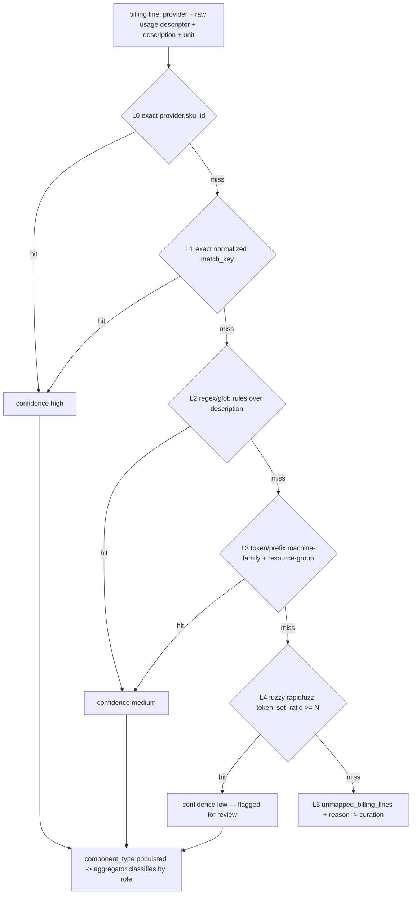

# Acurácia do SKU Matching

> Complementa [`architecture.md`](architecture.md) e
> [`capacity-pool-model.md`](capacity-pool-model.md). Descreve **como** billing
> lines are matched to SKU metadata / service ontology so that the Capacity Pool
> Model receives correctly classified input. 
> Implementation is broken into independent work units (§6) for a future batch.

## 0. Context

The billing pipeline currently classifies only **~48% of cost** correctly. On the
reference GCP report (`5d9bc55e`, $27,825) the **orphan rate is 51.9%** ($14,430,
98 orphan SKUs) and only **16.9%** becomes real compute pools
([`capacity-pool-model.md`](capacity-pool-model.md) §4, "E2E Test Results"). With more than
half of spend landing in the orphan bucket, the portability score and migration
recommendations are not trustworthy.

The cause is **not** missing data — it is **how** we match a billing line to the
ontology / catalog. Root-causes, confirmed by reading the code:

1. **The SKU catalog is never consulted during enrichment.**
   [`build_billing_enriched.py:144-146`](../app/use_cases/analysis/build_billing_enriched.py)
   writes `sku_metadata=None`, `pricing_source="missing"`,
   `pricing_confidence="low"` *hardcoded*. Enriched rows leave the stage with no
   vcpus / ram / role.
2. **Ontology lookup is an exact string match**
   ([`pg_service_ontology_repo.py:18-19`](../app/infrastructure/repositories/pg_service_ontology_repo.py),
   `usage_type == ...`). GCP SKUs are long free-text strings ("E2 Instance Core
   running in Americas") → almost nothing matches. No normalization, regex, token,
   or fuzzy layer exists.
3. **`sku_id` key mismatch.** Enrichment sets `sku_id = raw_payload["UsageType"]`
   (a description —
   [`build_billing_enriched.py:113-119`](../app/use_cases/analysis/build_billing_enriched.py)),
   but the catalog is keyed by **structured machine-type**
   (`e2-standard-2`, `BoxUsage:m7g.medium` —
   [`seed_catalog_pareto.py:13,86`](../app/infrastructure/database/seed_catalog_pareto.py)).
   So `catalog.get(item.sku_id)`
   ([`billing_aggregator.py:137`](../app/services/billing_aggregator.py)) misses
   → `desc=None` → every classifier (`_is_gke_control_plane`, `_is_gcp_core`, …)
   falls through to **orphan**.
4. **Catalog `description` is always empty.** The seed writes `attributes="{}"`
   hardcoded
   ([`seed_catalog_pareto.py:165`](../app/infrastructure/database/seed_catalog_pareto.py)),
   so `_load_catalog` reads `description=""`
   ([`billing_aggregator.py:220`](../app/services/billing_aggregator.py)). The
   regex-over-`description` classification never has text to match. There is no
   `component_type` (role) field on
   [`cloud_sku.py`](../app/domain/entities/cloud_sku.py) that would replace this
   fragile regex.
5. **Provider case mismatch.** Catalog uses `'GCP'`
   ([`seed_catalog_pareto.py:84`](../app/infrastructure/database/seed_catalog_pareto.py));
   `item.provider.value` uses `'gcp'`. `_load_catalog(source_provider)` does a
   case-sensitive lookup, so even a correct key would miss across providers.
6. **Small catalog coverage** (AWS-centric seeds); ~110 GCP SKUs from the report
   have no structured entry.

**Why it matters:** the score and recommendations are downstream of this matching.
If 52% of cost is orphan, the LLM (`capacity-pool-model.md` §3) reasons over a
half-empty picture and emits directional, low-confidence migrations.

## 1. Goals

- **G1 — Coverage.** `sku_coverage_ratio = mapped_cost / total_cost ≥ 0.95`
  (orphan ≤ 5%) on report `5d9bc55e`.
- **G2 — Deterministic & data-driven.** Matching is driven by versioned data
  (catalog + rules table), **zero `if/else` per cloud in Python** — consistent with
  the repo's non-negotiable rules ([`architecture.md`](architecture.md) and the
  existing `equivalence_matcher` precedent).
- **G3 — Traceable confidence.** Every enriched line carries `mapping_confidence`
  and `match_layer` (which ladder rung matched), propagated to `migration_context`.
- **G4 — Accounting integrity.** No regression: `Σpools + Σauxiliary + Σorphan ==
  total_spend` for every report (preserves the FOCUS guarantee in
  [`capacity-pool-model.md`](capacity-pool-model.md) §2.4).

## 2. Non-Goals

- No real pricing. The mock pricing path stays (`pricing_source` enums from
  [`architecture.md`](architecture.md) unchanged); accuracy is about **classification**,
  not price collection.
- No LLM for classification when a rule or catalog entry exists. LLM remains a
  last-resort fallback only (aligns with [`architecture.md`](architecture.md)).
- No runtime scraping (aligns with [`architecture.md`](architecture.md)).
- No change to the scoring model ([`architecture.md`](architecture.md)).

## 3. Data Contracts

### 3.1 `cloud_sku_catalog.component_type` (new)

The role of a SKU, so the aggregator classifies by data instead of regex:

```
component_type ∈ {
  core | ram | os_license | storage_ssd | storage_hdd |
  network_egress | gke_control_plane | database | unclassified
}
```

**Trade-off (recommended decision):**

| Option | Pros | Cons |
|---|---|---|
| Store in `attributes` JSONB | No migration | Not indexable; perpetuates the `attributes="{}"` bug (#4) |
| **Dedicated column (recommended)** | Indexable, typed, NOT NULL default `unclassified` | One Alembic migration |

Recommend the **dedicated column** + fixing the hardcoded `attributes="{}"` in the
seed so `description` is actually persisted (needed by L2/L3 below).

### 3.2 `billing_enriched` — new traceability fields

Two new columns, propagated to the agent payload:

```
mapping_confidence ∈ { high | medium | low }
match_layer        ∈ { L0 | L1 | L2 | L3 | L4 | L5 | LN }
```

`LN` (natureza) fica fora da escada: linha de compromisso de export detalhado
(`SavingsPlanRecurringFee`, `RIFee`, SKU `Commitment…` do GCP) é classificada
pela natureza que o próprio provedor informa (`charge_kind = commitment`), com
confiança `high`. Pela escada, `ComputeSP:3yrNoUpfront` casava `computesp:*`
como `core`, e as horas do plano viravam vCPU. Linhas de imposto, crédito,
reembolso e ajuste (`charge_kind` fora da base) nem chegam à escada. Ver
[`PLANO_CUR_BIGQUERY.md`](../PLANO_CUR_BIGQUERY.md) (RN2).

O **descritor** vem de `billing_items.usage_type` quando o parser é de export
detalhado (CUR `line_item_usage_type`, BigQuery `sku.description`); o caminho
legado continua lendo do `raw_payload` (`UsageType`, `SKU description`).

Relationship to existing enums ([`architecture.md`](architecture.md)): `match_layer`
is *orthogonal* to `pricing_source`/`pricing_confidence`. `mapping_confidence`
describes **classification** certainty (did we identify the role/family?);
`pricing_confidence` describes **price** certainty. A line can be
`mapping_confidence=high` (catalog hit) but `pricing_confidence=low` (mock price).

```json
{
  "provider": "gcp",
  "service_name": "Compute Engine",
  "sku_id": "e2-standard-2",
  "usage_type": "E2 Instance Core running in Americas",
  "component_type": "core",
  "match_layer": "L2",
  "mapping_confidence": "medium",
  "pricing_source": "sku_catalog",
  "pricing_confidence": "low"
}
```

### 3.3 `match_key` — normalized matching key

A derived, normalized form used by L1+ so trivial textual variance does not block a
match. Normalization is deterministic and order-fixed:

```
match_key = collapse_whitespace(trim(lowercase(casefold(raw))))
```

Applied to both the billing descriptor and the catalog key/description before
comparison. Provider is normalized via `normalize_provider()` (§5) on both sides.

## 4. The Matching Ladder

The heart of the spec: a deterministic cascade. The first rung that hits wins;
remaining rungs are skipped. Each rung assigns a `match_layer` and a
`mapping_confidence`.



| Rung | Strategy | Key | Confidence | `match_layer` |
|---|---|---|---|---|
| **L0** | Exact `(provider, sku_id)` against catalog | structured SKU id | high | `L0` |
| **L1** | Exact on normalized `match_key` | normalized | high | `L1` |
| **L2** | Regex/glob rules over `description` | `sku_classification_rules` | medium | `L2` |
| **L3** | Token/prefix by machine-family + FOCUS resource-group | family tokens | medium | `L3` |
| **L4** | Fuzzy `rapidfuzz.token_set_ratio ≥ N` vs ontology service names | fuzzy | low (review) | `L4` |
| **L5** | No match → dead-letter | — | — | `L5` |

**L2 rule examples (GCP):**

| `description` glob | `component_type` | family |
|---|---|---|
| `*Instance Core running in*` | `core` | extracted (E2/N2/…) |
| `*Ram running in*` | `ram` | extracted |
| `*Kubernetes*cluster*fee*` / `*GKE*management*` | `gke_control_plane` | — |
| `*Network*Egress*` / `*Inter-region*` | `network_egress` | — |
| `*SSD*` storage | `storage_ssd` | — |
| `*Balanced PD Capacity*` / `*Extreme PD Capacity*` | `storage_ssd` | — |
| `*PD Capacity*` (o que sobra: Standard PD) | `storage_hdd` | — |
| `*Cloud SQL*` / `*db-custom-*` | `database` | — |

### 4.1 `sku_classification_rules` (new table)

Rules live in data, versioned like the ontology — **never** as Python `if/else`:

```sql
CREATE TABLE sku_classification_rules (
    id               UUID            PRIMARY KEY DEFAULT gen_random_uuid(),
    provider         VARCHAR(10)     NOT NULL,
    pattern          TEXT            NOT NULL,   -- glob or regex
    kind             VARCHAR(10)     NOT NULL,   -- 'glob' | 'regex'
    component_type   VARCHAR(30)     NOT NULL,
    family           VARCHAR(30),                -- nullable; extracted if NULL
    confidence       VARCHAR(10)     NOT NULL DEFAULT 'medium',
    priority         INTEGER         NOT NULL DEFAULT 100,  -- lower = first
    active           BOOLEAN         NOT NULL DEFAULT true,
    created_at       TIMESTAMPTZ     NOT NULL DEFAULT NOW()
);

CREATE INDEX ix_sku_rules_provider_priority
  ON sku_classification_rules (provider, priority) WHERE active;
```

Evaluation order is `priority ASC`; first matching rule wins. This mirrors
`service_ontology`'s versioning model ([`data-model.md`](data-model.md)).

## 5. Behavior (Key Rules)

1. **Resolution order** is strictly L0 → L5; never re-evaluate later rungs after a
   hit.
2. **Separate `catalog key` from `raw usage descriptor`.** Stop overloading
   `sku_id` with `raw_payload["UsageType"]`
   ([`build_billing_enriched.py:113-119`](../app/use_cases/analysis/build_billing_enriched.py)).
   The descriptor feeds the ladder; the **matched** structured SKU id is what gets
   stored in `sku_id`. This removes the `catalog.get(sku_id)` dependency in
   [`billing_aggregator.py:137-182`](../app/services/billing_aggregator.py).
3. **Aggregator classifies by `component_type`**, not by regex over a (usually
   empty) `description`. The `_is_gcp_core` / `_is_gcp_ram` / `_is_gke_control_plane`
   helpers become a dispatch on `component_type`.
4. **`normalize_provider()`** is the single normalization point (`'GCP'`/`'gcp'` →
   canonical lowercase), applied in `_load_catalog`, the ontology repo, and the
   matcher — fixing root-cause #5.
5. **Confidence propagation.** `mapping_confidence` + `match_layer` flow from the
   matcher → `billing_enriched` → `migration_context` (so agents see how trustworthy
   each line is).
6. **Graceful degradation.** A line that reaches L5 goes to `unmapped_billing_lines`
   with a `reason` and **never** breaks the pipeline (aligns with
   [`architecture.md`](architecture.md)).
7. **No LLM override.** When L0–L3 produce a deterministic result, the LLM must not
   reclassify ([`architecture.md`](architecture.md)).

## 6. Required Changes (future implementation work units)

Each unit is independent and mergeable on its own — this list becomes the future
batch. Dependency order is roughly U5 → (U1, U4) → U2/U3 → U6 → U7/U8.

| # | Work unit | Touches |
|---|---|---|
| **U1** | Join the catalog during enrichment (populate `sku_metadata`/source/confidence; replace hardcode) | `build_billing_enriched.py:144-146` |
| **U2** | `sku_classification_rules` table + repo + initial GCP seed (Pareto top-95% of cost) | new migration, new repo, seed |
| **U3** | `SkuMatcher` service implementing the L0–L5 ladder (replaces exact lookup) | new service; `pg_service_ontology_repo.py` |
| **U4** | `component_type` on catalog + aggregator reclassified by role | `cloud_sku.py`, `seed_catalog_pareto.py`, `billing_aggregator.py` |
| **U5** | `normalize_provider()` + `match_key` everywhere (fix case-sensitive `_load_catalog` and `attributes="{}"` seed) | `billing_aggregator.py:212-229`, seed |
| **U6** | Expand GCP catalog/ontology coverage (the 98 orphan SKUs of `5d9bc55e`) | seeds |
| **U7** | Accuracy metric + golden-report test gate | new test harness (§8) |
| **U8** | Propagate `mapping_confidence`/`match_layer` to `migration_context` | enriched entity, migration-context builder |

## 7. Acceptance Criteria (measurable)

- `sku_coverage_ratio = mapped_cost / total_cost ≥ 0.95` on report `5d9bc55e`.
- `orphan_ratio ≤ 0.05` (aligns with the 5% governance flag already in
  [`capacity-pool-model.md`](capacity-pool-model.md) §2.3 / §4).
- Breakdown of mapped cost by `mapping_confidence` is reported (high/medium/low).
- Accounting integrity preserved: `Σpools + Σauxiliary + Σorphan == total_spend`.
- **GKE control plane** and **Cloud SQL** lines no longer fall into orphan (they
  land in `gke_control_plane` / `database` respectively).

## 8. Accuracy Metric & Test Harness

**Deterministic metric** (computed from `billing_enriched` + aggregator output):

```
total_cost   = Σ cost of all non-summary lines
orphan_cost  = AuxiliaryCosts.orphan
mapped_cost  = total_cost - orphan_cost
coverage     = mapped_cost / total_cost
orphan_ratio = orphan_cost / total_cost
```

**Golden test (contract).** Fixture = parsed `5d9bc55e` GCP report. The test asserts
`coverage ≥ 0.95`, `orphan_ratio ≤ 0.05`, the accounting-integrity equality, and a
non-empty `database`/`gke_control_plane` bucket. This becomes a **merge gate**,
replacing the earlier qualitative ">90% mapped" criterion.

## 9. Risks & Mitigations

| Risk | Mitigation |
|---|---|
| Ambiguous regex (one description matches two rules) | `priority`-ordered rules; prefer L0/L1 structured `sku_id` for ambiguous cases |
| New/unknown SKU drift over time | L5 dead-letter feeds a curation queue (`unmapped_billing_lines.reason`); rules/catalog updated as data |
| Fuzzy false positives (L4) | High threshold `N`, `mapping_confidence=low`, flagged for human review — never silently trusted |
| Provider case drift reappears | Single `normalize_provider()` choke point with a unit test |
